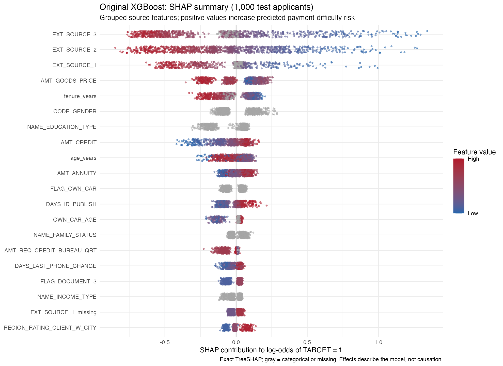
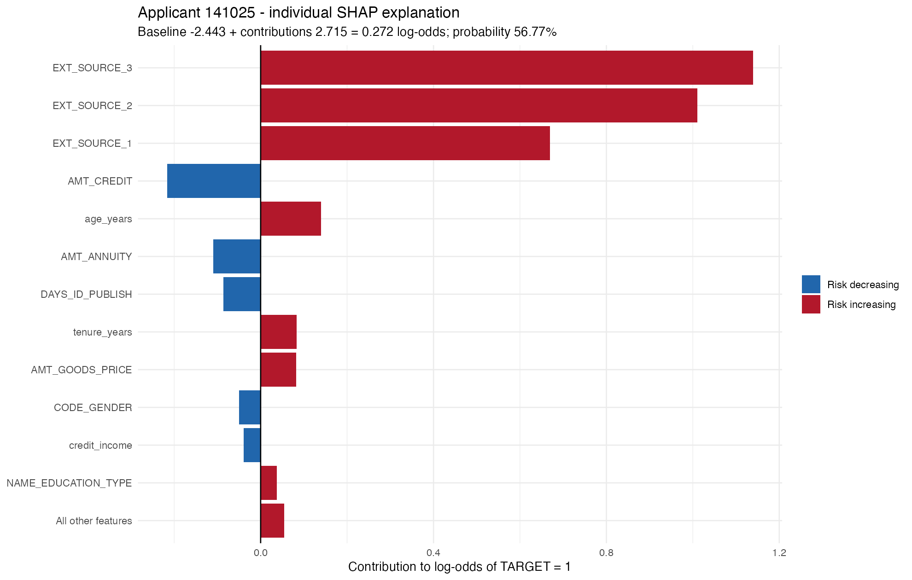

# Executive summary

Home Credit aims to expand credit access for people with limited credit histories while keeping lending risk under control. This project evaluates an XGBoost model trained on historical application data to predict payment difficulty and support credit approval decisions.

The selected model achieved a cross-validated ROC-AUC of 0.7535 and a holdout ROC-AUC of 0.7576. These results suggest that the model can reasonably distinguish between higher- and lower-risk applicants.

To evaluate its business value, we tested different approval thresholds using estimated lending gains and losses. A threshold of 0.10 produced the highest estimated net benefit. On the holdout data, this policy approved 73.8% of applicants, with a 4.32% payment-difficulty rate among approved borrowers. Compared with the standard 0.50 threshold, the estimated financial benefit increased by 43.5%. This is a simulation based on historical data and assumed costs, not actual profit.

The analysis also identified some important limitations. External risk scores were the strongest predictors, but their underlying definitions are unknown. The model also relies on sensitive attributes, including gender, and approval rates differed across gender and education groups. Some model predictions could not be translated into sufficiently specific reasons for credit denial.

Given these findings, I would not recommend automated deployment at this stage. The model could be considered for a limited, supervised pilot after reviewing sensitive predictors, validating financial assumptions and probability calibration, and improving the explanations provided for declined applications.

# Model details

The selected model is an XGBoost classifier using Feature Set C, with 132 application-level predictors, including the features developed during data preparation.

We selected the original XGBoost configuration after comparing it with the tuned alternative, which showed lower cross-validation performance.

| Parameter | Value |
|---|---|
| Model | XGBoost classifier |
| Model version | Original XGBoost — Feature Set C (untuned) |
| Number of predictors | 132 |
| Trees | 200 |
| Maximum tree depth | 4 |
| Learning rate | 0.05 |
| Minimum node size | 10 |

The model uses median imputation for missing numeric values, dummy encoding for categorical variables, and removal of zero-variance predictors.

We used 246,008 applications for model development and reserved 61,503 for holdout evaluation. After selecting the model, we trained the final version on all 307,511 labeled applications.

# Intended use

The model is designed to support Home Credit's credit risk and underwriting teams in assessing applicants' repayment risk. It estimates the probability of payment difficulty (`TARGET = 1`) based on application-level data.

Its main purpose is to help evaluate credit approval policies, balancing access to credit with the risk of lending to applicants who may struggle with repayment.

The model is not intended to make automatic lending decisions without human oversight. It should not be used independently to determine loan terms, interest rates, or credit limits. Its use with other populations or lending products would require further validation.

# Data

The analysis uses the Home Credit Default Risk dataset from Kaggle, focusing on two application-level files: `application_train.csv`, with 307,511 labeled applications, and `application_test.csv`, with 48,744 applications without known outcomes.

Each row represents one loan application. The target variable (`TARGET`) indicates whether the applicant experienced payment difficulty (1) or not (0). We used only application-level data, leaving the other available credit-history tables outside the scope of this model.

Data preparation included correcting documented invalid values, converting age and employment duration into years, creating loan-to-income ratios, and adding missingness indicators. The labeled data were split into 80% for development and 20% for holdout evaluation.

# Performance metrics

The selected XGBoost model achieved a mean ROC-AUC of 0.7535 in three-fold cross-validation and 0.7576 on the holdout dataset. The Kaggle public and private scores were 0.7420 and 0.7412, respectively, showing reasonably consistent performance across the evaluations.

| Evaluation | Metric | Result |
|---|---|---:|
| Cross-validation (3 folds) | ROC-AUC | 0.7535 |
| Holdout (61,503 applications) | ROC-AUC | 0.7576 |
| Kaggle Public | ROC-AUC | 0.7420 |
| Kaggle Private | ROC-AUC | 0.7412 |
| Holdout (threshold = 0.10) | Precision | 18.33% |
| Holdout (threshold = 0.10) | Recall | 60.13% |

At the selected threshold, the model identified about 60% of applicants who experienced payment difficulty. However, only 18.33% of those flagged actually experienced this outcome.

These results suggest that the model can distinguish between applicants with different risk levels, although its predictions are not sufficiently accurate to support automatic rejection decisions without further review.

# Decision threshold

We evaluated approval thresholds from 0.01 to 0.50 to find the level that maximizes estimated financial benefit.

The analysis used a median gross spread of 10.62%, calculated from Home Credit application data, and an assumed recovery rate of 13.5%, based on two-year recoveries of charged-off U.S. credit card debt reported by the CFPB (2025). These assumptions represent simplified lending economics, not Home Credit's actual profit and loss figures.

A threshold of 0.10 produced the highest estimated net benefit using out-of-fold predictions. We then applied this threshold to the holdout dataset without further adjustment.

| Holdout results | Threshold 0.10 | Threshold 0.50 |
|---|---:|---:|
| Approval rate | 73.80% | 99.84% |
| Payment difficulty among approved | 4.32% | 7.90% |
| Estimated net benefit | 1.822 billion | 1.270 billion |

Under these assumptions, the selected threshold increased estimated net benefit by 43.5% compared with 0.50.

We also tested different financial scenarios by varying the estimated gain and recovery rates. The preferred threshold ranged from 0.08 to 0.14, suggesting some consistency within the assumptions tested.

```{r}
#| label: financial-sensitivity-table
#| echo: false
sensitivity <- read.csv("assets/model_card/original_xgboost_financial_sensitivity_selected.csv")
thresholds <- as.matrix(xtabs(threshold ~ gain_multiplier + recovery_rate, sensitivity))
dimnames(thresholds) <- list(c("Gain -25%", "Base gain", "Gain +25%"),
                            c("Recovery 8.5%", "Recovery 13.5%", "Recovery 20%"))
knitr::kable(thresholds, digits = 2,
             caption = "OOF-selected thresholds under alternative financial assumptions")
```

These financial results are simulations expressed in dataset monetary units. The gross spread excludes operating and funding costs, while `TARGET` measures payment difficulty rather than confirmed financial loss. Actual lending outcomes may differ.

# Explanations and adverse action mapping

We used SHAP to explain the model's predictions on a random sample of 1,000 applicants. The three external risk scores (`EXT_SOURCE_1`, `EXT_SOURCE_2`, and `EXT_SOURCE_3`) were the strongest predictors. Lower scores generally increased estimated payment risk. Employment tenure and loan characteristics also influenced the predictions.



For an illustrative applicant (ID 141025), the model predicted a 56.77% probability of payment difficulty, above the 0.10 approval cutoff used in the policy simulation. The external scores contributed most to the elevated risk, followed by shorter employment tenure and the reported price of financed goods.



The table below translates these contributions into possible explanations.

| Feature | Candidate explanation |
|---|---|
| `EXT_SOURCE_1/2/3` | Low external risk scores |
| `tenure_years` | Short time in current employment |
| `AMT_GOODS_PRICE` | Financed-goods price contributed to higher estimated risk |

These explanations have limitations. The dataset does not describe how the external scores are calculated, and goods price alone does not establish insufficient repayment capacity. The model also uses sensitive attributes, including gender and age, which should not be presented as denial reasons.

SHAP contributions describe model behavior, not the causes of payment difficulty. Further validation would be needed before these explanations could support actual credit denial notices.

# Fairness

We evaluated approval rates by gender and education level using the 61,503 holdout applications and the selected threshold of 0.10.

| Group | Approval rate | Approval ratio |
|---|---:|---:|
| **Gender** | | |
| Female | 79.07% | 1.000 |
| Male | 63.74% | 0.806 |
| **Education** | | |
| Academic degree | 72.73% | 0.842 |
| Higher education | 86.34% | 1.000 |
| Incomplete higher | 68.16% | 0.790 |
| Lower secondary | 66.33% | 0.768 |
| Secondary / secondary special | 69.91% | 0.810 |

Men had a 15.33 percentage-point lower approval rate than women, and their false-decline rate was also higher (32.75% versus 18.44%). Applicants with incomplete higher and lower secondary education had approval ratios below the 0.80 screening reference.

These differences do not establish discrimination, but they deserve further investigation. The 80% rule is used here as a descriptive screening measure, not a legal compliance test. Results for small groups, particularly applicants with an academic degree (n = 33), should be interpreted cautiously.

Another concern is that gender ranked sixth in SHAP feature importance. The use of sensitive attributes and the observed approval disparities would need to be reviewed before considering deployment.

# Limitations and risks

The model was developed using historical Home Credit application data and may not reflect current lending conditions. It also uses only application-level information, leaving out additional credit-history tables and some measures of repayment capacity, such as existing debt obligations and living expenses.

The financial analysis relies on simplified assumptions about lending gains and losses. Since `TARGET` measures payment difficulty rather than actual financial loss, the estimated net benefit should not be interpreted as expected profit. Probability calibration also remains unverified.

The model uses sensitive attributes, including gender, and shows differences in approval rates across demographic groups. In addition, the limited information about external risk scores makes some credit denial explanations difficult to justify.

Before deployment, I would recommend reviewing sensitive predictors, validating financial assumptions and probability calibration, and improving the explanations for rejected applications. Model performance and approval disparities would also need continued monitoring.

# References

1. Home Credit Group. (2018). *Home Credit Default Risk*. Kaggle. [Competition and dataset](https://www.kaggle.com/competitions/home-credit-default-risk). Data definitions from `HomeCredit_columns_description.csv`.

2. Consumer Financial Protection Bureau. (2025). *The Consumer Credit Card Market*. [Report](https://www.consumerfinance.gov/data-research/research-reports/the-consumer-credit-card-market-2025/). Source for the assumed 13.5% recovery rate.

3. Lundberg, S. M., & Lee, S.-I. (2017). *A Unified Approach to Interpreting Model Predictions*. Advances in Neural Information Processing Systems, 30. [Paper](https://papers.neurips.cc/paper/2017/hash/8a20a8621978632d76c43dfd28b67767-Abstract.html).

4. Consumer Financial Protection Bureau. *Regulation B, 12 CFR § 1002.9*. [Adverse action notifications](https://www.consumerfinance.gov/rules-policy/regulations/1002/9/).

5. U.S. Equal Employment Opportunity Commission. (1979). *Questions and Answers on the Uniform Guidelines on Employee Selection Procedures*. [Guidance](https://www.eeoc.gov/laws/guidance/questions-and-answers-clarify-and-provide-common-interpretation-uniform-guidelines).
